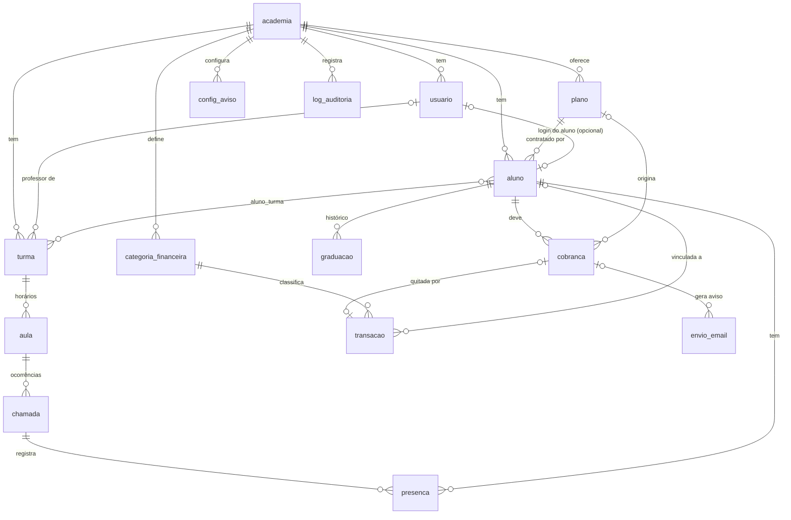

# Modelo de banco de dados

O modelo executável está em [`db/schema.sql`](./db/schema.sql) (PostgreSQL 15+). Este documento explica **por que** ele é assim.
O arquivo foi carregado em um PostgreSQL 16 limpo e passou por um teste de fumaça (graduação atualizando a faixa do aluno,
inadimplência e frequência calculadas, e as restrições de integridade rejeitando dados inválidos).

Módulo Comunicados **não** existe no modelo (foi removido do produto). O que existe de "aviso" são os e-mails automáticos de
cobrança, ligados por `config_aviso` e registrados em `envio_email`.

## Diagrama

## Tabelas por bloco do produto

| Bloco | Tabelas | Observação |
|---|---|---|
| Base | `academia`, `usuario` | `usuario.aluno_id` só existe para o papel `aluno` (restrição no banco) |
| Alunos e planos | `aluno`, `plano` | Aluno guarda consentimento LGPD e autorização de imagem |
| Turmas e agenda | `turma`, `aluno_turma`, `aula` | `aula` = horário recorrente. `aluno_turma` **é novo**: o protótipo não tinha esse vínculo |
| Presença | `chamada`, `presenca` | `chamada` = uma ocorrência concreta de uma `aula` em uma data |
| Progresso | `graduacao` | Histórico append-only; um *trigger* atualiza a faixa atual do aluno |
| Financeiro | `categoria_financeira`, `cobranca`, `transacao` | `cobranca` = o que se espera receber; `transacao` = o que entrou ou saiu |
| E-mail | `config_aviso`, `envio_email` | Interruptores de Configurações + controle de envio |
| Segurança | `log_auditoria` | Quem mudou o quê |

## Decisões e o motivo de cada uma

1. **Dinheiro em centavos (`integer`).** Nunca `float`. O front trabalha em reais (`valor: 180`); a conversão acontece **uma única vez**, na camada
   de API (Fase 2 do roadmap).
2. **`academia_id` em toda tabela de negócio**, mesmo com uma academia só. Adicionar depois é migração dolorosa; deixar agora não custa nada.
3. **Dado derivado não é gravado.** O protótipo guardava `statusPagamento` e `frequencia30d` dentro do aluno; isso envelhece no minuto seguinte.
   No banco são *views*:
   - `v_aluno_pagamento`: `atrasado` = existe cobrança **aberta com vencimento no passado**; `vence_em_breve` = vence em até 5 dias (o número 5 é suposição minha, o protótipo não define a regra); senão `em_dia`.
     Por isso o enum `status_cobranca` **não tem** "atrasada" — ela é uma consequência da data, e uma rotina que "marca atrasos" poderia falhar e deixar o dado errado.
   - `v_aluno_frequencia_30d`: presentes ÷ chamadas **fechadas** das turmas do aluno nos últimos 30 dias.
   - `v_fluxo_mensal`: receita e despesa por mês.
4. **`chamada` separada de `aula`.** `aula` é "segunda, 19h"; `chamada` é "segunda, dia 13". Sem isso não dá para registrar uma aula extra,
   cancelada, ou reposição. `unique (aula_id, data)` impede chamada duplicada.
5. **`cobranca` separada de `transacao`.** Uma é a expectativa, a outra é o fato. Sem essa separação não existe relatório de inadimplência confiável.
   `transacao.cobranca_id` é `unique`: um pagamento quita no máximo uma cobrança. A baixa deve criar a transação e marcar a cobrança **na mesma transação de banco**.
6. **`cobranca.competencia` é sempre o dia 1 do mês** (`check`), e `unique (aluno_id, competencia)` torna a geração mensal **idempotente**: rodar duas vezes não cobra duas vezes.
7. **`graduacao` é histórico; `aluno.faixa/graus` é o estado atual.** O trigger `aplicar_graduacao` mantém os dois alinhados dentro da mesma transação.
   Não use `UPDATE` direto em `aluno.faixa` — registre uma graduação.
8. **`envio_email` com índice único `(tipo, cobranca_id)`.** A rotina diária grava a intenção de envio *antes* de chamar o provedor; se rodar duas vezes,
   o banco recusa a duplicata. É o que impede o aluno de receber o mesmo lembrete duas vezes.
9. **`turma.infantil`** substitui a regra escondida no protótipo (ids fixos `t3` e `t4`). Combinado com `aluno_turma`, a chamada passa a listar
   **quem está matriculado na turma**, não quem "parece" infantil.
10. **`vencimento_dia` de 1 a 28.** Evita o dia 29/30/31, que não existe em todo mês. O protótipo aceita até 31; o formulário deve ser ajustado.
11. **`categoria_financeira` é tabela, não lista fixa no código.** O professor deve poder criar as categorias que ele usa (pendência **E4**).
12. **LGPD no cadastro.** `consentimento_em`, `consentimento_por` e `uso_imagem_autorizado`. Aluno **menor de idade exige responsável** — o banco garante que
    nome e telefone do responsável vêm juntos; a regra "menor precisa de responsável" depende da data de hoje e por isso é validada na aplicação.
13. **`usuario` sem senha.** Com Supabase Auth, `usuario.id` é o id do `auth.users`. Com autenticação própria, adicionar `senha_hash` (Argon2id).
    A unicidade do e-mail é por academia e ignora maiúsculas.

## O que ainda depende de resposta da academia

| Ponto do modelo | Pendência |
|---|---|
| `aluno_turma` — um aluno em várias turmas? | E5 |
| `vencimento_dia` — fixo para todos ou por aluno? | E3 |
| `plano` — trancamento, desconto família, taxa de matrícula não estão modelados | E2 |
| `categoria_financeira` — lista inicial | E4 |
| Campos extras de `aluno` (CPF, endereço, contato de emergência, atestado) | E6 |
| Regra de elegibilidade à graduação (por faixa, tempo e frequência) — hoje não há tabela de regras | E1 |
| Aula cancelada / feriado — ainda sem tabela de exceções | E11 |

As IDs (E1…E13) referem-se ao [`ROADMAP.md`](./ROADMAP.md#22-para-ver-com-a-academia-levar-na-sessão-de-validação).

## Ordem de criação (migrações)

Mesma ordem em que o produto é construído (veja o roadmap). O arquivo `schema.sql` já traz tudo; ao adotar uma ferramenta de migração
(Prisma, Drizzle, Supabase CLI), divida assim:

| Migração | Conteúdo | Fase |
|---|---|---|
| 001 | tipos, `academia`, `plano`, `aluno`, `usuario`, `log_auditoria` | 2–3 |
| 002 | `turma`, `aluno_turma`, `aula`, `chamada`, `presenca` | 4 |
| 003 | `categoria_financeira`, `cobranca`, `transacao`, `v_aluno_pagamento`, `v_fluxo_mensal` | 5 |
| 004 | `graduacao` + trigger, `v_aluno_frequencia_30d` | 6 |
| 005 | `config_aviso`, `envio_email` | 7 |

## Consultas que o Painel passa a fazer no servidor

| Hoje no front (`selectors.ts`) | No banco |
|---|---|
| `inadimplentes()` | `v_aluno_pagamento where status_pagamento = 'atrasado'` |
| `vencendoEmBreve()` | `v_aluno_pagamento where status_pagamento = 'vence_em_breve'` |
| `fluxoDoMes()` / `serieFinanceira()` | `v_fluxo_mensal` |
| `taxaPresenca()` | média sobre `presenca` das `chamada` fechadas nos últimos 30 dias |
| `novasMatriculas()` | `count(*) from aluno where date_trunc('month', matricula_em) = date_trunc('month', current_date)` |

## Limitações conhecidas desta versão

- `v_aluno_frequencia_30d` calcula sobre as turmas do aluno **no período**; um aluno sem turma vinculada aparece com 0%. A importação da planilha precisa criar os vínculos.
- A view percorre `chamada` e `presenca` por aluno. Para centenas de alunos é instantâneo; se o volume crescer muito, vira *materialized view* ou cache.
- Não há tabela de **feriados / aulas canceladas**, nem de **regras de graduação** configuráveis. Entram quando E1 e E11 forem respondidas.
- Políticas de acesso por linha (RLS, se a opção A do roadmap for escolhida) **não** estão neste arquivo: dependem de como a autenticação for ligada
  e devem ser escritas e testadas na Fase 2/8.
